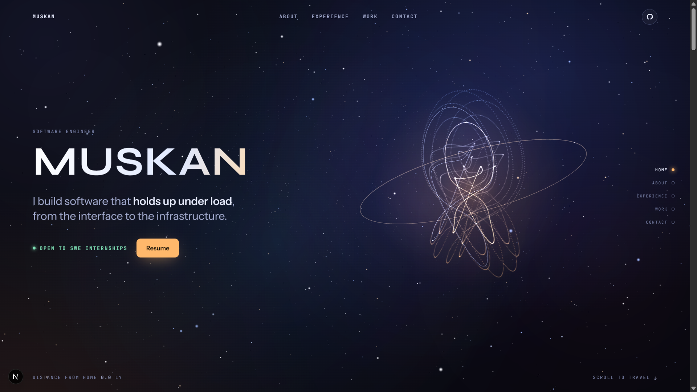

# Muskan

> A scroll-driven, space-themed portfolio for software engineering work — from the interface to the infrastructure.

[](https://nextjs.org/)
[](https://react.dev/)
[](https://www.typescriptlang.org/)
[](https://threejs.org/)

[**Live Portfolio**](https://muskanbuilds.vercel.app/) · [**Source Code**](https://github.com/muskan-g72/portfolio) · [**Features**](#features) · [**Run Locally**](#run-locally)

## Preview



This portfolio presents experience, selected projects, and contact details through a single immersive journey. The home route renders a client-side Three.js scene: scrolling moves the camera through distinct About, Experience, Work, and Contact stops while the content panel changes with the active destination.

The visual language is intentionally dark, technical, and space-inspired. A sticky viewport, animated star field, 3D objects, project cards, and pointer interaction create the main experience; a responsive fallback keeps the portfolio usable when WebGL is unavailable.

## Features

| Area | What it does |
| --- | --- |
| **Space journey** | Maps scroll progress to camera movement across Home, About, Experience, Work, and Contact destinations. |
| **Interactive 3D scene** | Renders a custom Three.js star field, nebula haze, and distinct 3D objects for each destination. |
| **Portfolio content** | Surfaces education, experience, selected project details, and direct contact links. |
| **Project showcase** | Presents VeriGate, Orchestrix, RateShield, and TaskForge with project-specific external links. |
| **Responsive access** | Supports keyboard-focus styles, reduced-motion preferences, mobile navigation, and a no-WebGL fallback. |
| **Resume access** | Keeps the resume available as a PDF and through the dedicated `/resume` page. |

## Tech Stack

| Layer | Technologies |
| --- | --- |
| Framework | Next.js 16.3.8, React 19.2.8, TypeScript |
| Visuals & motion | Three.js 0.128.0, Framer Motion 14, GSAP 3 |
| Styling | Tailwind CSS 4, scoped CSS for the space experience |
| Tooling | ESLint 9, Playwright |

## Run Locally

**Prerequisite:** Node.js 20.9 or later.

```bash
git clone https://github.com/muskan-g72/portfolio.git
cd portfolio
npm install
npm run dev
```

Open [http://localhost:3000](http://localhost:3000) in your browser.

| Command | Purpose |
| --- | --- |
| `npm run dev` | Start the Next.js development server. |
| `npm run lint` | Run ESLint. |
| `npm run build` | Create a production build. |
| `npm run start` | Serve a completed production build. |

## Project Structure

```text
app/
├── page.tsx                     # Home route; renders the space experience
├── layout.tsx                   # Root metadata, fonts, providers, and global styles
├── globals.css                  # Application-wide styles
├── (site)/
│   ├── layout.tsx               # Shared layout for inner site routes
│   ├── resume/page.tsx          # Resume viewer and PDF download page
│   └── work/[slug]/page.tsx     # Project case-study route
├── robots.ts                    # Robots metadata
└── sitemap.ts                   # Sitemap metadata
components/
├── space-hero/
│   ├── SpaceHero.tsx            # Hero markup, navigation, and WebGL fallback
│   ├── scene.ts                 # Three.js scene, camera, scroll, and pointer behavior
│   ├── content.ts               # Space stops, hero projects, and contact links
│   └── space-hero.css           # Scoped hero styling and responsive rules
├── case/                        # Project case-study components
├── contact/                     # Contact section
├── experience/                  # Experience section
└── ui/                          # Command palette and shared UI
content/
├── content.ts                   # Portfolio copy, projects, navigation, and contact data
└── types.ts                     # Content model types
public/
├── resume.pdf                   # Downloadable resume
├── screenshots/                 # README and project screenshots
└── shots/                       # Project imagery used by the space scene
next.config.ts                   # Next.js configuration
postcss.config.mjs               # Tailwind PostCSS plugin configuration
```

## Customization

| To change | Update |
| --- | --- |
| Main portfolio copy, structured project pages, navigation, and contact details | [`content/content.ts`](content/content.ts) |
| Space-scene stops, hero project cards, and hero contact links | [`components/space-hero/content.ts`](components/space-hero/content.ts) |
| Camera, scroll, pointer, and 3D object behavior | [`components/space-hero/scene.ts`](components/space-hero/scene.ts) |
| Hero styling and responsive behavior | [`components/space-hero/space-hero.css`](components/space-hero/space-hero.css) |
| Resume document | [`public/resume.pdf`](public/resume.pdf) |
| Project imagery | [`public/shots`](public/shots) and [`public/screenshots`](public/screenshots) |

## Deployment

The portfolio is deployed on Vercel at [muskanbuilds.vercel.app](https://muskanbuilds.vercel.app/). This repository has no `vercel.json`; it uses the standard Next.js build command:

```bash
npm run build
```

To deploy, import the repository into Vercel or connect it to an existing Vercel project. Vercel detects the Next.js application and uses the production build output; no repository deployment settings need to change for the documented workflow.

## Author

Built by [Muskan](https://muskanbuilds.vercel.app/).

[Portfolio](https://muskanbuilds.vercel.app/) · [GitHub](https://github.com/muskan-g72) · [LinkedIn](https://www.linkedin.com/in/muskan72gulia72)
